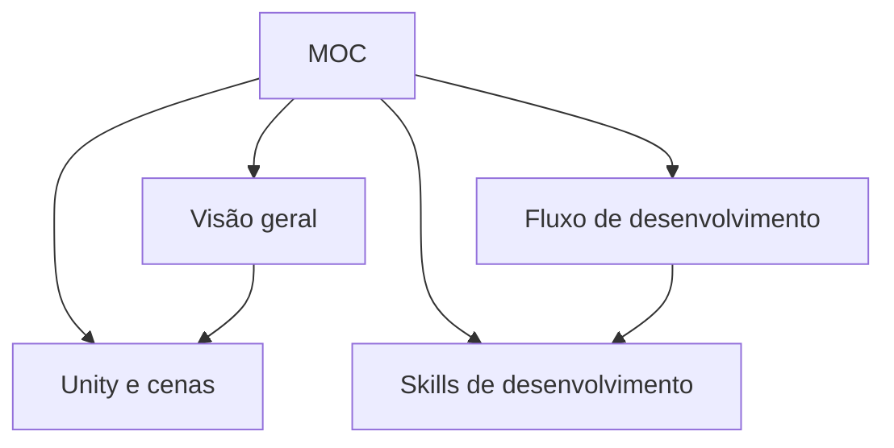

# MOC — Action Adventure Lucca

## Projeto
- [[Visao-geral]] — escopo, engine e organização do jogo.
- [[Fluxo-de-desenvolvimento]] — ciclo de trabalho e validação.

## Sistemas Unity
- [[Unity-e-cenas]] — cenas, objetos e integração com o Editor.

## Conhecimento
- [[Skills-de-desenvolvimento]] — skills locais e catálogo de game dev.

