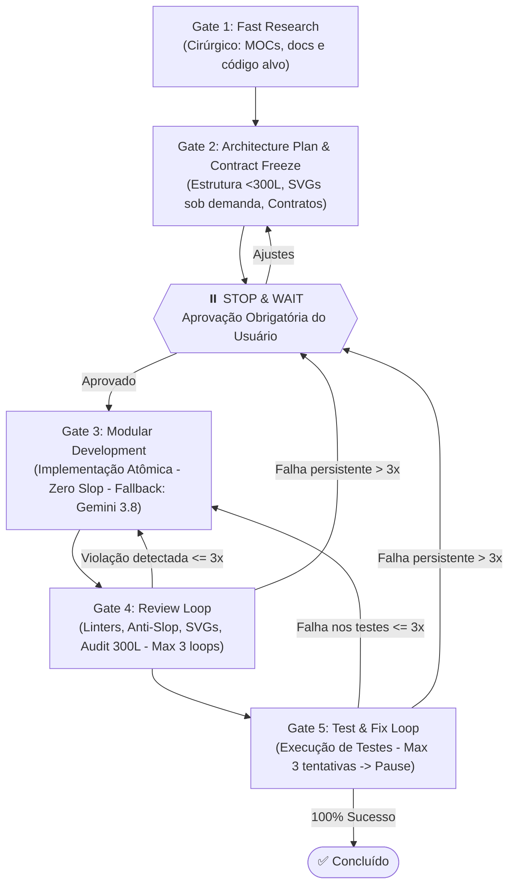

# Rennan Dev Cycle (Antigravity 2.0 Adaptive Multi-Agent & Guardrails)

Este protocolo é a metodologia **padrão e obrigatória** para desenvolvimento de software, arquitetura, refatoração, UI/UX, documentação e testes. Ele possui **detecção automática inteligente entre Quick-Fix e Ciclo Completo**, economia agressiva de tokens, engenharia limpa sem "AI Slop", iconografia profissional em SVG sob demanda (sem baixar pacotes inteiros) e salvaguardas contra engessamento ou loops infinitos.

> **Gatilhos**: Ativado automaticamente em qualquer tarefa de engenharia/desenvolvimento de software ou sob demanda através do comando `/rennan-dev-cycle`.

---

## ⚡ 1. Detecção Automática de Modo (Dual-Mode Execution)

O assistente deve classificar **automaticamente** a complexidade do pedido do usuário antes de iniciar, sem exigir comandos decorados:

### Modo A: Quick-Fix Automático (Sem Burocracia)
- **Critérios de Ativação Automática**:
  - Correção de bugs pontuais, typos, pequenos erros de lógica ou sintaxe;
  - Ajustes de estilo/CSS, textos ou configurações simples;
  - Alterações estimadas em **1 a 2 arquivos** e **menos de 30 linhas modificadas**;
  - Tarefas explícitas de correção rápida ("arruma isso", "ajuste esse botão", "o teste X quebrou").
- **Fluxo Ágil**:
  1. Executa a leitura cirúrgica (`StartLine`/`EndLine`).
  2. Aplica a correção diretamente sem desenhar planos extensos nem diagramas Mermaid.
  3. Executa verificação rápida/testes locais.
  4. Reporta a alteração de forma concisa.

### Modo B: Ciclo Completo dos 5 Gates (Full Protocol)
- **Critérios de Ativação Automática**:
  - Criação de novas funcionalidades (features) ou módulos do zero;
  - Refatorações estruturais ou migrações de arquitetura;
  - Alterações que afetam múltiplos arquivos ou contratos de banco/API;
  - Pedidos amplos ("implemente o sistema de autenticação", "estruture a nova página de dashboard").
- **Fluxo**: Executa rigorosamente os **5 Gates com parada mandatória para aprovação no Gate 2**.

---

## 🎨 2. Iconografia Profissional em SVG Sob Demanda (Regra Anti-Emoji & Anti-Bloat)

1. **PROIBIÇÃO ABSOLUTA DE EMOJIS COMO ÍCONES**:
   - Emojis (🔍, ⚙️, 🚀, 📁, ❌, ✅, etc.) **NUNCA** devem ser utilizados como elementos de interface (botões, menus, navegação, cards, badges ou avatares).
2. **ÍCONES SVG SOB DEMANDA (ZERO DEPENDÊNCIAS PESADAS)**:
   - **NÃO instale pacotes npm/bibliotecas inteiras de ícones** (ex: pacotes gigantes de milhares de ícones) apenas para usar 2 ou 3 ícones.
   - **Padrão Obrigatório**:
     - Gere o código vetorial do **SVG inline diretamente** ou crie um arquivo dedicado e enxuto de ícones do projeto (ex: `assets/icons.svg`, `icons.ts` ou componentes SVG puros independentes de framework).
     - Utilize padrões limpos de SVG com `viewBox="0 0 24 24"`, `fill="none"`, `stroke="currentColor"` e classes utilitárias de dimensionamento e cor (`class="w-4 h-4 text-muted"`).
     - Se o projeto já tiver uma biblioteca de ícones instalada previamente, utilize os ícones dela por importação cirúrgica. Nunca instale novas libs de ícones sem necessidade.

---

## 🚫 3. Anti-AI Slop: Padrões de Código, Docs e Comunicação

### A. Slop em Código e Documentação Técnica
1. **Zero Comentários "Capitão Óbvio"**:
   - Proibido comentar o que o código já deixa evidente (`// busca usuário`, `// retorna json`).
   - **DOCUMENTAÇÃO CRÍTICA DO "PORQUÊ" (OBRIGATÓRIA)**: É obrigatório comentar lógicas de negócio complexas, algoritmos não triviais, regex obscuros, fórmulas matemáticas ou contornos (workarounds) de bugs externos. Explique o *racional* e as *restrições*, nunca a mecânica óbvia.
2. **Zero Abstrações Vazias / Wrappers Falsos**:
   - Não crie classes ou funções que apenas repassam chamadas sem adicionar valor real.
3. **Nomenclatura Natural**:
   - Use nomes diretos e técnicos (`syncSession`, `parsePayload`, `userStore`), evitando adjetivos de IA (`comprehensiveDataHandler`).

### B. Vocabulário Proibido & Exceção de Domínio Técnico
- **Palavras Banidas em Textos e MOCs**: `delve`, `streamline`, `robust`, `cutting-edge`, `paradigm shift`, `empower`, `leverage`, `seamless`, `tapestry`, `game changer`, `transformative`, `elevate`, `embark`, `supercharge`, `harness`, `multifaceted`.
- **Exceção de Domínio Técnico Legítimo**:
  - A regra se aplica a **retórica e adjetivos vazios**. Termos técnicos de APIs, frameworks ou regras de negócio reais (ex: `data stream`, `financial leverage`, `AWS test harness`) são permitidos quando forem o identificador técnico correto.
- **Fatos Concretos em vez de Adjetivos Inflados**:
  - Substitua adjetivos pomposos por métricas reais (ex: *"Cache em memória com TTL de 15min e latência <5ms"*).

### C. Comunicação Direta (Zero "Throat-Clearing")
- Elimine introduções vazias (*"In today's fast-paced world..."*, *"It is worth noting that..."*).
- Vá direto ao ponto: o que foi feito, o que precisa de aprovação e status dos testes.

---

## 🛡️ 4. Guardrails Operacionais & Flexibilidade de Contrato

1. **Circuit Breaker (Teto de 3 Tentativas)**:
   - Limite máximo de **3 tentativas** de correção autônoma nos testes/linters. Se falhar na 3ª, pause imediatamente, mostre o log e peça orientação humana.
2. **Evolução Não-Destrutiva de Contratos (Pragmatic Contract Evolution)**:
   - Os contratos (`types.ts`) aprovados no Gate 2 são a base da implementação.
   - **Adições Não-Quebrantes**: Se durante a codificação (Gate 3) o agente perceber a necessidade de uma propriedade opcional nova (ex: `isLoading?: boolean`, `error?: string`), ele pode adicioná-la sem travar o processo, reportando a adição no Review (Gate 4).
   - **Mudanças Quebrantes**: Alterar nomes de campos existentes ou quebrar tipagem já consolidada continua exigindo pausa e alinhamento.
3. **Modularização Pragmática (Anti-Overengineering)**:
   - A regra das 300 linhas combate monólitos, **não para fragmentar prematuramente**. Se um arquivo for pequeno (<100–150 linhas) e coeso, mantenha-o em um único arquivo.
4. **Delegação Proporcional ao Escopo**:
   - Tarefas pequenas/médias são feitas diretamente pelo agente principal. O squad é invocado sob demanda apenas para tarefas complexas.
5. **Notificação Obrigatória de Fallback**:
   - Se qualquer modelo avançado (`pro`, Opus, Sonnet, GPT-OSS 120B) falhar por cota, erro ou timeout, chavear para **Gemini 3.8 Flash (`flash`)** e **avisar explicitamente o usuário no chat**.
6. **MOCs de Alto Nível (Anti-Doc Rot)**:
   - Documente no Segundo Cérebro apenas conceitos centrais e fluxos principais, sem poluir com micro-funções.

---

## 🤖 5. Squad de Subagentes Especializados & Matriz de Modelos

| Papel do Subagente | Foco de Atuação | Classe de Modelo (`Model`) | Perfil de Referência | Nível de Effort | Permissões |
| :--- | :--- | :--- | :--- | :--- | :--- |
| **`agent-research`** | Pesquisa externa de APIs, leitura de docs e MOCs sem poluir contexto | `flash` | Gemini 3.8 Flash | **Low–Medium** | Somente Leitura (Read-only) |
| **`agent-frontend`** | Componentes de UI, styling, UX e SVGs sob demanda | `pro` / `inherit` | Claude Sonnet 5.5 | **Medium–High** | Escrita (UI, Components, Hooks) |
| **`agent-backend`** | Arquitetura de dados, serviços, regras de negócio complexas e segurança | `pro` | Claude Opus 5.5 | **High** (Deep Reasoning) | Escrita (Services, API, Models) |
| **`agent-qa-tester`** | Criação de testes unitários/E2E, auditoria de 300L/Slop e loops de fix | `flash` (unit) / `pro` (E2E) | GPT-OSS 120B | **Dinâmico** | Escrita + Execução de Testes |

---

## ⚡ 6. Diretrizes de Otimização & Economia de Tokens

1. **The 300-Line Rule (Limite Rígido de Arquivo)**:
   - Nenhum arquivo de código novo ou modificado deve exceder 300 linhas.
2. **Separação Rígida de Responsabilidades**:
   - UI para renderização, Custom Hooks para lógica de estado complexa, contratos em `types.ts`.
3. **Leitura Cirúrgica (Anti-Bloat)**:
   - Use `StartLine` e `EndLine` para fatiar leituras. NUNCA leia arquivos grandes inteiros.
4. **Documentos Index-First**:
   - Sem documentos monolíticos. Índices leves apontando para arquivos temáticos em `docs/`.
5. **Knowledge Items (KIs)**:
   - Registre no MOC notas curtas sobre lógicas complexas e estáveis para evitar releituras recorrentes.

---

## 🧠 7. Segundo Cérebro & Flow Graphs

1. **Map of Content (MOC)**: Manter ou atualizar `docs/MOC.md` como índice geral do projeto.
2. **Navegação com `[[wikilinks]]`**: Usar links bidirecionais conectando notas conceituais aos módulos.
3. **Mermaid Flow Graphs**: Todo fluxo relevante deve possuir diagrama visual (`flowchart TD` ou `sequenceDiagram`) para localização rápida de dependências.

---

## 🔄 8. O Protocolo dos 5 Portões (The 5 Gates - Modo Completo)

---

### Gate 1: Fast Research (Inspeção Cirúrgica & Zero Desperdício)
* Consultar índices (`docs/MOC.md`), grafos Mermaid e código alvo via `StartLine`/`EndLine`.
* Delegar ao `agent-research` (`flash`) apenas para pesquisas externas ou varreduras amplas.

---

### Gate 2: Architecture Plan & Contract Freeze (Ponto de Parada Mandatório)
* Apresentar plano contendo objetivo, arquivos (<300L), contratos de interfaces (`types.ts`), estratégia de SVGs sob demanda e diagrama Mermaid.
* **PARADA MANDATÓRIA**: O assistente deve pausar e perguntar:
  > *"O plano de arquitetura, os contratos e a modularização acima estão aprovados para início da implementação?"*
* **NÃO prosseguir para o Gate 3 sem a aprovação expressa do usuário.**

---

### Gate 3: Modular Development (Implementação Segura & Limpa)
* Implementar o código respeitando os contratos definidos.
* Permitida evolução não-destrutiva de contratos para campos opcionais novos.
* SVGs criados inline ou em módulo leve de assets, sem baixar pacotes inteiros de ícones.

---

### Gate 4: Review & Knowledge Sync Loop
* Executar linters, verificar regra das 300 linhas e ausência de emojis como ícones.
* Limpar qualquer AI slop ou comentários óbvios, assegurando documentação das lógicas complexas.
* Máximo de 3 loops de auto-correção.

---

### Gate 5: Test & Fix Loop (Validação com Circuit Breaker)
* Executar testes (`npm test`, `pytest`, etc.).
* Circuit breaker: até 3 tentativas de auto-correção. Na 3ª falha, pausa imediata e apresentação do erro para o usuário.
* Relatório final direto e objetivo.
